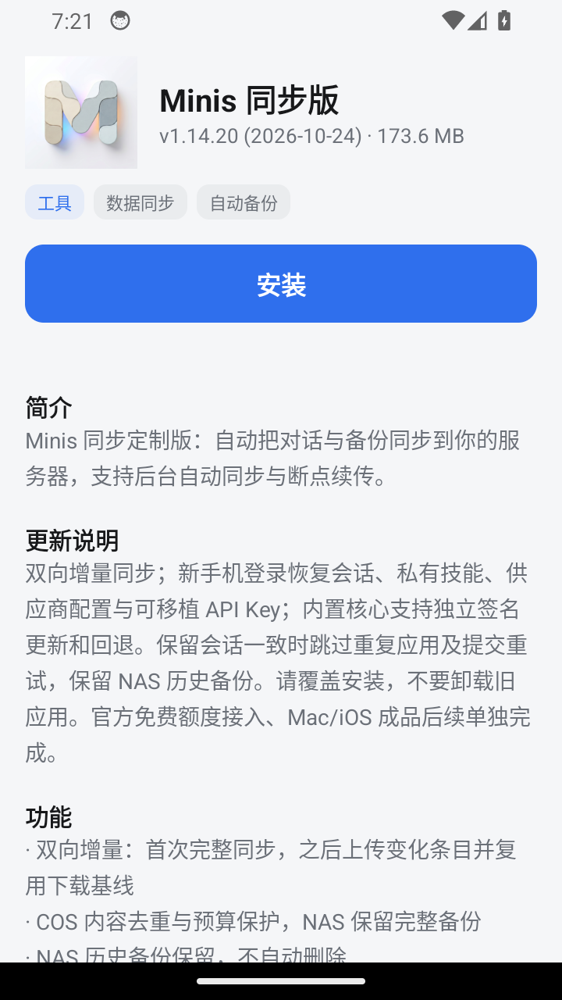

# Minis 同步版 1.14.20 / 121

状态：2026-10-24 已发布并上架；隔离Android34验收通过，另已补Android12实体设备的隔离包恢复验收；正式包119→121实体OTA与原数据保留已通过。Mac/iOS成品和官方免费额度接入后续单独完成。

## 产物

- 包名：`site.zhangyue.minis`；Android ARM64，minSdk26。
- 大小：181,999,862字节。
- SHA-256：`520ce0b8e3c4cc74b5c582d2f5d2c7ef36cd90563adccd56e86a92780998f24a`。
- 签名证书SHA-256：`b5aaac0eb0369165d34ee3bae1cddd637eaa2bc3566adf9e3f2dc2f5a1a473e4`。
- [正式下载](https://d.zhangyue.site/apps/minis-sync/releases/1.14.20/minis-sync-1.14.20.apk) · [商店页面](https://d.zhangyue.site/apps/minis-sync/)。
- 代码：[PR3](https://github.com/zhangyue-site/minis-sync/pull/3)、[PR4](https://github.com/zhangyue-site/minis-sync/pull/4)，功能合并提交 `acc5c617ff86469865575edb46dbefbdb6af9a7b`。构建依赖已验证119基包与外部签名/运行资源，非完整Gradle源码构建。

构建期间另一项发布已经上线120，本轮递增121且保留120不可变文件；对当前120基线进行版本/签名审核，通过。继承其会话一致时跳过重复应用和提交重试，保留NAS历史，不继承自动删旧调用。

## 验证结果

| 项目 | 结果与范围 |
| --- | --- |
| 身份/签名/版本 | 正式121与当前正式120基线审核通过；包名相同、版本递增、B5证书一致 |
| 后端 | Mac、106、124隔离测试103项通过；GitHub回归通过 |
| 核心更新 | Mac及GitHub16项测试通过；Android从公网获取签名包，更新后实际启动OpenCode1.18.3、ZCode CLI0.16.9、Node24.18.1，再回滚到内置版启动通过 |
| 双机恢复 | 两台隔离Android经真实HTTPS服务验证新机恢复真实Room会话/消息、私有技能、原生供应商API Key，第二台新增消息回传，已有数据保留 |
| 账号隔离 | 切换账号被阻止；另一普通账号读取已知摘要的包、manifest和差量接口均被拒绝 |
| 覆盖升级 | 121测试包覆盖120后会话、技能、Key保留并继续公网同步 |
| 真正客户端OTA | 正式119客户端发现/下载120、摘要与签名检查、系统安装确认、版本120和marker保留；随后120客户端同样完成121，系统版本121，119预置marker仍在。另已补实体正式119→121系统升级及原数据保留验收。目标APK实际下载摘要与本报告相同，未以ADB覆盖代替这条链路 |
| 公网下载 | 最终HTTPS包完整下载，大小和摘要一致；旧客户端实际下载再次核对同一摘要 |
| 商店/页面 | 实际apps.json、项目OTA入口、独立页均121；其他应用和商店自身字段保留。桌面浏览器显示121及正确下载地址；Android WebView宽360，内容宽360，无横向溢出 |
| 原生商店App | 稳定3.0.0仍存在已装状态错误；修复候选3.0.1在隔离设备实际显示“已安装/打开”并通过状态矩阵，但真机安装被Play保护扫描拦截，稳定更新已撤回，商店修复仍待验收 |
| 服务端数据 | 切换前SQLite备份；部署锁内逐表校验原有数据记录摘要不变，仅新增空配置确认表；使用隔离账号验证新功能 |
| DeepSeek模型审阅 | 未完成：指定deepseek-chat不再由既有网关提供，未用其他模型冒替。确定性云端测试与模型审阅分别记录 |
| 实体手机 | Android12正式119经真实客户端更新回执、清单与完整下载、系统安装完成121；升级前、升级后和首次启动后三份只读快照核对：原四张聊天表逐行内容、供应商配置/密钥文件与技能摘要一致。设备安装APK摘要与本报告一致；未卸载、清数据或用ADB覆盖正式包。此前隔离包首次恢复与手机提交也通过，另一端最终读回仍未续验 |

一次本机磁盘紧张使本轮模拟器暂停；仅清理经SHA确认的中间APK后恢复并重新请求OTA。测试夹具曾有编码、token路径及截图首帧问题，修正后重跑，不把失败尝试算作通过。

## 运行边界与回退

核心更新为用户触发的已验证版本维护，不自动追latest。APK内核心是兜底；新核心独立目录安装，健康检查失败保留当前指针，手动回退不覆盖后来产生的用户数据。数据库/登录格式变化和主版本需要单独迁移适配。

账号恢复当前覆盖可移植技能/供应商与API Key，设备OAuth不克隆；没有端到端加密或完整多账号工作区。安装绑定首个账号，切换时停止同步。共享会话不迁移正在执行的终端进程。

旧APK、版本清单和部署前元数据备份保留。服务端回退只恢复代码链接，不用旧数据库覆盖新同步内容；已装121的设备不能承诺直接降版本覆盖安装，应另发更高修复版本。具体备份和恢复路径只在维护者私有交接中保留。

## 完整发布流程复核（2026-10-24）

发布验收沿用上述同一SHA-256产物证据，不重打包、不覆盖121。已完成签名与版本检查、隔离环境覆盖数据保留、应用内真实OTA、官网及实际商店数据源登记、完整下载、账号恢复与隔离、核心独立更新及回退、GitHub正式Release。这里的应用商店指乐天自有商店，未向Google Play或苹果App Store提交。

本轮安全清理无占用的可重建Gradle transforms缓存，恢复隔离模拟器，保留AVD和用户数据。原生商店展示已补；修复候选的状态识别与同进程更新矩阵通过，但实体安装被Play保护机制拦截，稳定商店目录已恢复原版本，修复发布仍待验收。实体设备正式119→121 OTA/升级及首次启动后的原数据保留已通过；安装前已有私有完整快照，并保留恢复入口。指定DeepSeek本轮再次返回400 `unknown model: deepseek-chat`，模型审阅未完成。

测试包原先沿用正式版显示名称，容易混淆；本轮已停用实体设备上的测试包并保留数据，用户确认原正式版内容可见。后续QA构建将应用及activity/alias标签改为“Minis · 验收测试”；只读快照工具跳过MinisApp初始化，不触发同步或恢复，仅复制私有数据库、配置和技能并核对原文件摘要，在副本上检查SQLite。私有快照不进入Git或公开页面。相关操作见[隔离验收说明](ANDROID-QA.md)。

## 正式实体OTA补验收（2026-10-24）

更新前实际版本119；旧客户端此前已检查真实清单并下载121，保留pending_update回执中的目标版本、大小与SHA。服务端日志对应同一来源的清单请求和181,999,862字节完整下载，随后系统安装器完成更新，实际版本121。设备端对已安装base.apk计算SHA，与本报告最终产物相同；没有重发121或用ADB覆盖代替OTA。

先完成升级前只读备份，复制前后原文件与本机副本摘要一致，再执行系统升级。升级后及新版本首次启动后重复备份，在私有副本中逐行核对原业务表与配置、技能摘要。私人会话、凭据和快照未进入Git、模型请求或公共发行页。

配套商店修复仍有阻塞：[商店候选验收记录](https://github.com/xiaoletian64/letian-store/blob/codex/installed-status/docs/RELEASE-3.0.1.md)。真机旧商店数据已先备份，安装候选被系统保护扫描拦截后仍保留旧版，原备份范围文件摘要不变。旧3.0.0还缺少其安装器所需Provider，不能用新候选源码反推旧包具备该组件；不把失败的商店自更新写成通过。

后续更新沿用正式包名、兼容签名和递增版本号，先备份再覆盖升级，迁移另行验收。当前APK更新下载完整安装包；“双向增量”指会话同步的数据传输。独立核心更新仍使用版本目录和回退指针，不自动回滚用户后来产生的数据。
